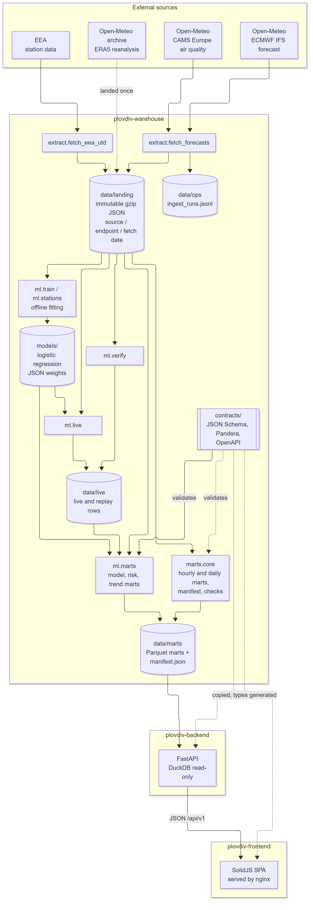
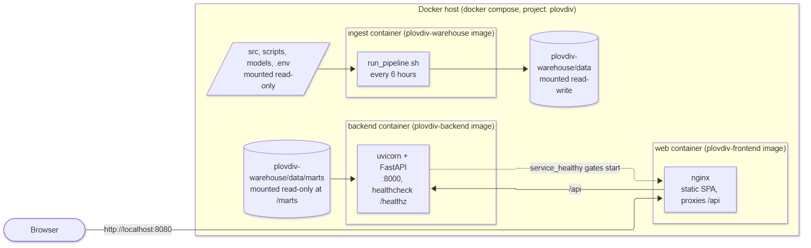
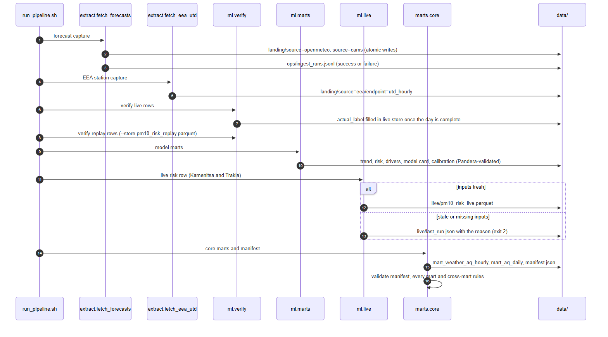
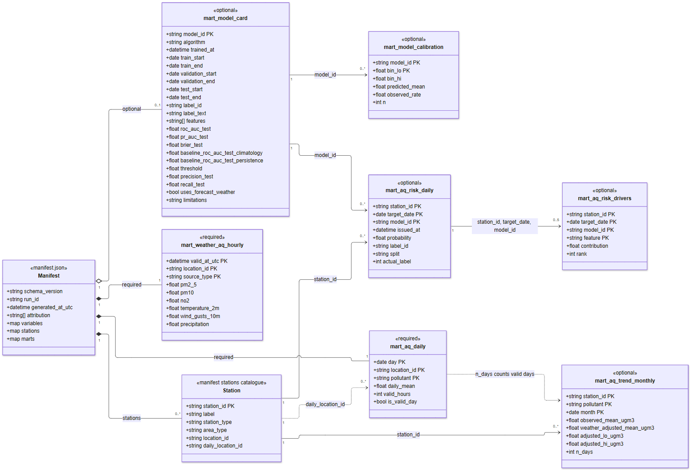
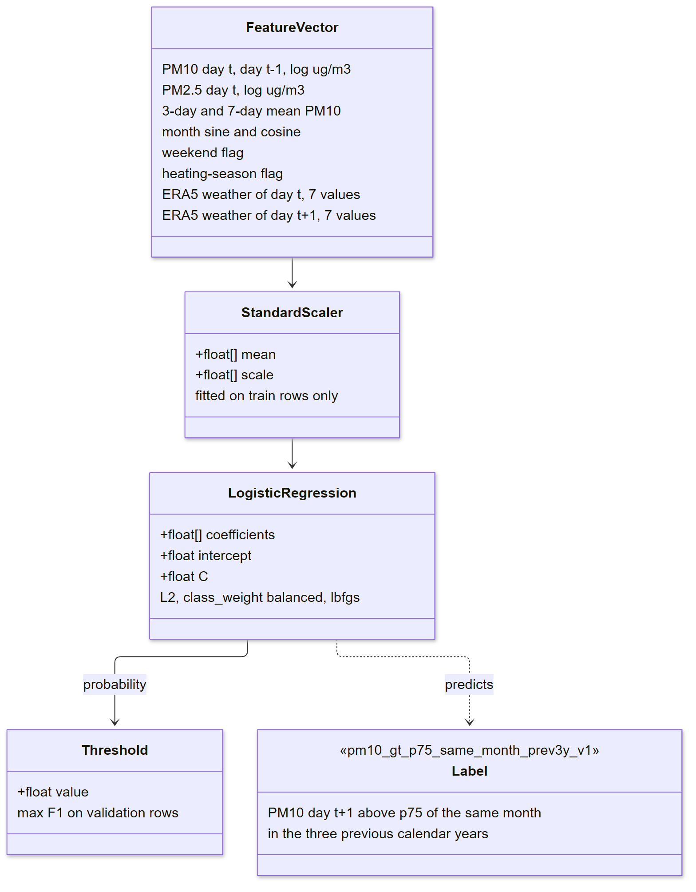
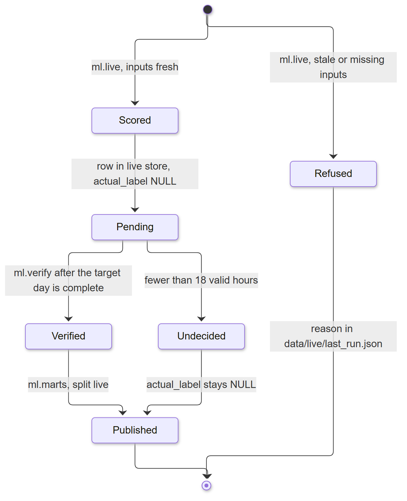
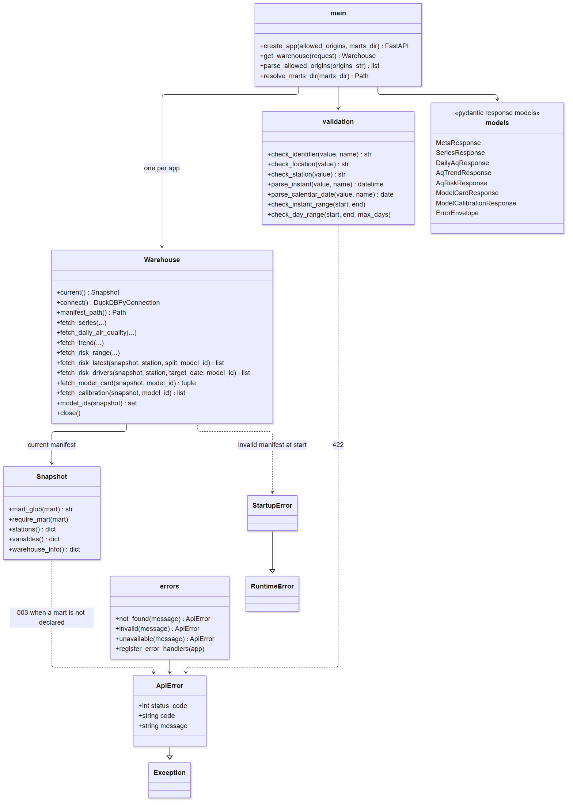
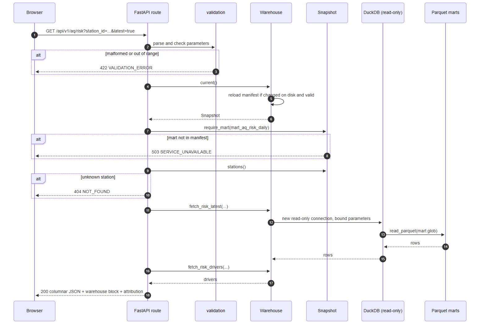
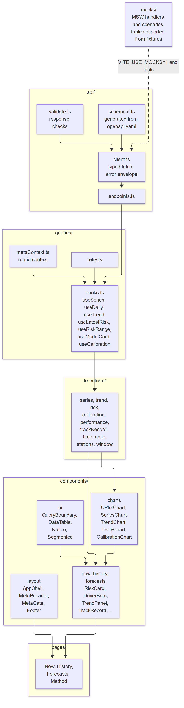

# WeatherCall

A weather and air-quality data platform for Plovdiv, Bulgaria. It captures weather and air-quality forecasts as they are issued, keeps their full history in a small warehouse, predicts next-day PM10 pollution risk, and serves everything through a read-only API and a dashboard.

Forecast services overwrite their output every few hours, so once a new forecast is out there is no way to check how good the old one was. WeatherCall keeps every forecast, unmodified, so forecasts, observations and errors can be compared over time.

## Contents

- [Repository layout](#repository-layout)
- [Architecture](#architecture)
- [Running the stack](#running-the-stack)
- [Warehouse](#warehouse-plovdiv-warehouse)
- [Data contract](#data-contract)
- [Next-day PM10 risk model](#next-day-pm10-risk-model)
- [Analytics API](#analytics-api-plovdiv-backend)
- [Dashboard](#dashboard-plovdiv-frontend)
- [Continuous integration](#continuous-integration)
- [Data sources and attribution](#data-sources-and-attribution)
- [License](#license)

## Repository layout

| Folder | What it is |
|---|---|
| [`plovdiv-warehouse`](plovdiv-warehouse) | Ingestion (Open-Meteo / ECMWF, CAMS Europe, EEA stations), mart builders, the PM10 risk model, and the data contract |
| [`plovdiv-backend`](plovdiv-backend) | Read-only FastAPI service over the published Parquet marts |
| [`plovdiv-frontend`](plovdiv-frontend) | SolidJS dashboard: current readings, risk card, trends, model calibration |
| [`plovdiv-stack`](plovdiv-stack/docker-compose.yml) | Docker Compose file that runs all three together |
| [`.github/workflows`](.github/workflows/ci.yml) | CI: tests for all three projects |

Each project folder keeps its own README with the same material in project-local form; this document is the combined reference.

## Architecture

All diagrams below describe what is implemented and running today. The dbt project in `plovdiv-warehouse/dbt/` and a Dagster orchestration layer are not part of the running pipeline and are not shown.

### Components



Design principles:

- **Raw data is immutable.** Everything downstream can be rebuilt from `landing/`.
- **Revisions are rows, not updates.** A provisional value and its later correction both exist.
- **UTC everywhere in the warehouse.** Local time (Europe/Sofia) is applied only for display. The autumn clock change makes a local day 25 hours long.
- **Regulatory rules are explicit.** Daily air-quality means follow the EEA rule that at least 18 of 24 hourly values must be valid.
- **Provenance on every value.** Each row is labelled `station`, `analysis`, `reanalysis_provisional`, `reanalysis_final` or `forecast`. Modelled values are never presented as measurements.
- **Tiny scale on purpose.** One city, hourly data, a few hundred thousand rows per year. The project is about correctness and modelling, not volume.

### Deployment



### One pipeline run

`plovdiv-warehouse/scripts/run_pipeline.sh` runs these steps in order. Each step logs its own outcome; a failed capture does not stop the later steps, so the marts are always rebuilt from whatever has landed.



## Running the stack

```bash
cp plovdiv-warehouse/.env.example plovdiv-warehouse/.env
cd plovdiv-stack
docker compose up -d --build
```

The dashboard is at http://localhost:8080. The `ingest` container runs `scripts/run_pipeline.sh` every 6 hours: forecast capture, EEA station download, verification of past live rows, model marts, live rows, core marts. Code and models are mounted read-only; `data/` is mounted read-write. The backend mounts `data/marts` read-only, and the web container starts only once the backend reports healthy. The dashboard shows data once marts have been built into `plovdiv-warehouse/data/marts`.

## Warehouse (`plovdiv-warehouse`)

### What it does

- Collects hourly weather forecasts (ECMWF IFS through Open-Meteo) and air-quality forecasts (CAMS Europe) every six hours, each source captured independently so a failure in one never costs the other's forecast vintage.
- Downloads EEA station data: verified daily E1a files (2013 to 2025) landed once, and unverified hourly PM10 for 2026 on every run, for both stations.
- Stores each raw response unchanged, so any later step can be rebuilt from the original data.
- Builds Parquet marts and a `manifest.json`, validated against the data contract, as the only interface to downstream applications.

### Status

| Area | State |
|---|---|
| Raw forecast capture (Open-Meteo, CAMS Europe) | Working, with retry, atomic writes and a wind-unit guard. Runs every 6 hours in the `ingest` container |
| Station observations (EEA) | Verified daily files (2013 to 2025) landed once; unverified hourly PM10 for 2026 on every run, both stations |
| Data contract, schemas and fixtures | Complete and tested |
| Next-day PM10 risk model (`src/plovdiv/ml`, `models/`) | Trained for Kamenitsa, plus a live model trained on Trakia's own record |
| Model and trend marts (`python -m plovdiv.ml.marts`) | Built and validated against the contract, real data, two stations |
| Required marts and `manifest.json` (`python -m plovdiv.marts.core`) | Built and validated from real landed files by a direct landing-to-mart path. `manifest.json` is the authoritative manifest |
| Live risk rows (`python -m plovdiv.ml.live`) | Scored on every run for Kamenitsa and Trakia, then checked against the station by `python -m plovdiv.ml.verify` once the day is complete |
| dbt models (`dbt/`) | Staging and mart models exist but are not run by the pipeline |
| Orchestration (Dagster), backfills, revision sweeps | Planned |

### Getting started

Requires Python 3.12 or newer.

```powershell
cd plovdiv-warehouse
python -m venv .venv
.\.venv\Scripts\Activate.ps1
pip install -e ".[dev]"
copy .env.example .env
python -m pytest
```

The tests of the risk model and the marts also need `scikit-learn` and `joblib` (the `ml` extra). Tests that need the real landed files and the trained model skip when those are absent.

Capture one set of forecasts into `data/landing/`:

```powershell
python src\plovdiv\extract\fetch_forecasts.py
```

The script exits with a non-zero status if either source failed or the wind-unit check did not pass. To schedule the capture every six hours on Windows outside Docker (the task wakes the PC and runs missed starts when it comes back):

```powershell
.\scripts\register_capture_task.ps1
```

### Model and trend marts

```powershell
$env:PYTHONPATH = "src"
python -m plovdiv.ml.marts
```

It reads `models/` and the latest partition under `data/landing/` (options: `--models-dir`, `--eea-dir`, `--weather-file`, `--out-dir`, `--replicates`, `--generated-at`, `--strict`), validates every mart with the Pandera schemas in `contracts/schemas.py`, and writes `data/marts/<mart>/latest/<mart>.parquet`. A mart that fails its schema is not written; the reason is printed and stored in `data/marts/diagnostics/build_report.json`. The output is deterministic: sorted rows, fixed seeds, rounded values, fixed Parquet settings, no pandas metadata and no wall-clock time, so two runs on the same inputs write identical bytes (tested).

| Mart | Rows | Content |
|---|---|---|
| `mart_aq_trend_monthly` | 264 | Monthly observed and weather-adjusted PM10 for BG0051A (Kamenitsa, 2013 to 2025) and BG0078A (Trakia, 2017 to 2025), with a 90 percent block-bootstrap interval. Months with fewer than 15 valid days have no adjusted value. Method: [`docs/METHODS_trend.md`](plovdiv-warehouse/docs/METHODS_trend.md) |
| `mart_aq_risk_daily` | 3540 | Next-day probability of a "bad PM10 day" for validation (2021 to 2022) and test (2023 to 2025) days, plus live and replay rows. Training days are in-sample and are not published |
| `mart_aq_risk_drivers` | 5320 | The five largest contributions to the log-odds (coefficient times standardised value) for each test day of the primary model. Contributions plus intercept reproduce the model's logit (tested to 1e-6) |
| `mart_model_calibration` | 20 | Ten reliability bins on the test years for each of the two models |
| `mart_model_card` | 2 | One row per model: windows, test metrics, baselines, threshold and limitations |

Limits of these marts:

- **Weather stand-in.** The primary model (`pm10_risk_logreg`) uses ERA5 actual weather of the target day in place of a forecast, so its scores are an upper bound. The second model (`pm10_risk_logreg_no_next_day_weather`) uses only information known at the end of the previous day.
- **Relative label.** A bad day is a day above the 75th percentile of the same calendar month in the three previous years, so about a quarter of days are positive by construction.
- **Issue time.** For evaluation rows, `issued_at` is a convention: the end of day t in UTC, which is 00:00 UTC of the target date. It is not the time a live system produced the value.
- **Drivers** are published for the test split only.
- **Model card dates.** `trained_at` is the date the fitting ran (2026-10-07). It can fall after the test years because the windows, not that date, decide which rows were used. The contract checks the ordering of the three windows and that `trained_at` is not before the training window ended.

### Required marts and the manifest

Until dbt runs in the pipeline, the two required marts are built by a small deterministic builder that reads the landing files directly.

```powershell
$env:PYTHONPATH = "src"
python -m plovdiv.ml.marts      # optional marts first (model, risk, trend)
python -m plovdiv.marts.core    # required marts, then data/marts/manifest.json, then the checks
```

Options: `--landing-dir`, `--eea-dir`, `--out-dir`, `--generated-at` (default: the latest fetch date of the inputs at 00:00 UTC) and `--check-only` (validate an existing output without building). The command exits with status 1 when the output is not valid.

| Mart | Source | Content |
|---|---|---|
| `mart_aq_daily` | EEA E1a daily station means, continued with daily means of the hourly 2026 files | One row per day, location and pollutant. A missing day or an invalid record is a row with NULL mean, `valid_hours` 0 and `is_valid_day` false |
| `mart_weather_aq_hourly` | CAMS Europe and Open-Meteo (ECMWF IFS) snapshots | One row per hour and `source_type`. Hours up to the capture are `analysis`, later hours are `forecast`. Modelled grid values, never measurements |

The command writes `data/marts/manifest.json` (counts and ranges read back from the Parquet files; `run_id` is a hash of the input and output bytes, not of the clock) and checks the whole output: the manifest against `contracts/manifest.schema.json`, every Parquet file against its Pandera schema, and the rules that tie the marts together (variables and units, stations, model ids, drivers against risk rows, labelled days against valid PM10 days, `n_days` of the trend against the valid days of the daily mart). `manifest.partial.json`, an earlier partial manifest, is kept only for reference.

What the contract cannot say about this data, and what the builder does about it (details in [`docs/CORE_MARTS.md`](plovdiv-warehouse/docs/CORE_MARTS.md)):

- **`valid_hours` is a lower bound.** The source reports daily means and no hourly count, so a valid EEA day is published with `valid_hours` 18 (or the reported data capture times 24 when given).
- **One daily series per location.** Kamenitsa (BG0051A) is location `plovdiv`; Trakia (BG0078A) is published as location `plovdiv-trakia`.
- **No forecast issue time.** The hourly mart keeps the latest snapshot for each hour and `source_type`; older forecast vintages stay in `data/landing/`.
- **Unit corrections.** Units are read from the files. A snapshot that reports wind in km/h is converted to m/s.

### Outages and recovery

Every capture attempt, successful or not, is appended to `data/ops/ingest_runs.jsonl`. To see when capture stopped and resumed:

```powershell
python -m plovdiv.ops.gaps
```

For each gap the report gives the last successful capture, when capture resumed, the number of missed runs, whether the program did not run (`no_run`) or ran and failed (`failed`), and the window to backfill.

| Data | After a gap |
|---|---|
| Analysis-like recent values | Every snapshot includes the last 3 days (weather) or 7 days (CAMS). A shorter gap is covered by the next snapshot; a longer one is backfilled from the archive APIs |
| Forecast vintages issued during the gap | Lost. Open-Meteo's Previous Runs API can restore some weather leads for 2024 onward. CAMS vintages cannot be restored |

Gaps are kept as data: forecast-error tables must treat a missing vintage as missing, never as zero or as an interpolated value.

### Configuration

Settings are read from `plovdiv-warehouse/.env` (see `.env.example`):

| Variable | Meaning |
|---|---|
| `LATITUDE`, `LONGITUDE` | Requested point. The services snap it to their own grid, and the echoed coordinates are stored with each response |
| `WEATHER_API_URL`, `AQ_API_URL` | Open-Meteo endpoints |
| `USER_AGENT` | Identifies the project in requests |
| `OPENMETEO_API_KEY` | Optional |

### Layout

```
contracts/    data contract, schemas, fixture generator
src/plovdiv/  extract (capture), ml (risk model, model marts, live scoring), marts (required marts and manifest), ops (gap report)
models/       trained PM10 risk models, metrics and predictions
docs/         CORE_MARTS.md, LIVE_FORECAST_PATH.md, METHODS_trend.md
scripts/      run_pipeline.sh, register_capture_task.ps1
tests/        test suite
dbt/          dbt project (not run by the pipeline)
data/         landing, live, ops and marts (not tracked)
```

## Data contract

`plovdiv-warehouse/contracts/` is the contract between the warehouse and its consumers. The warehouse owns it; `plovdiv-backend` and `plovdiv-frontend` keep verbatim copies and must not edit them. To change the contract, change it in the warehouse, regenerate the fixtures and copy the directory again.

| File | Purpose |
|---|---|
| `version.py` | Single definition of `SCHEMA_VERSION` |
| `manifest.schema.json` | JSON Schema (draft-07) for `manifest.json` |
| `openapi.yaml` | OpenAPI 3.0.3 description of the API |
| `schemas.py` | Pandera schemas for every mart |
| `make_fixtures.py` | Deterministic fixture generator (fixed seed, byte-identical output, LF line endings) |
| `fixtures/` | Valid, synthetic fixtures: `manifest.json` and one Parquet file per mart |
| `fixtures_invalid/` | Deliberately wrong hourly and daily data and a wrong manifest, used to prove validation fails |

### Versioning

`SCHEMA_VERSION` is `"1"`. It is checked in `manifest.schema.json` (`const`), in `openapi.yaml` (`info.version`) and by every consumer at startup.

Adding optional marts, optional manifest fields, endpoints or optional response fields does not change the version. Renaming or removing a field, changing a type or the meaning of a column, or making an optional part required does, and then every place that checks the version in all three projects must be updated together. Because `marts` in `manifest.schema.json` does not allow unknown entries, a consumer holding an older copy rejects a manifest that declares new marts: copy the contract to the consumers before publishing such a run.

### Mart data model

Every mart is published as `<mart>/latest/*.parquet`; the manifest gives the glob, the row count and the ranges. The diagram shows the columns enforced by `contracts/schemas.py` and the keys that tie the marts together. Station ids are declared in the manifest `stations` catalogue, model ids in `mart_model_card`.



Domain values enforced by the schemas:

| Column | Values |
|---|---|
| `source_type` | `station`, `analysis`, `reanalysis_provisional`, `reanalysis_final`, `forecast` |
| `pollutant` | `pm2_5`, `pm10`, `no2` |
| `split` | `train`, `validation`, `test`, `live`, `replay` |

Row rules enforced by the schemas include: `is_valid_day` exactly when `valid_hours >= 18`; `observed_mean_ugm3` NULL exactly when `n_days` is 0; the adjusted mean and its bounds NULL together and ordered `lo <= mean <= hi`; `issued_at` before the end of the target EEA day; driver ranks running 1..k by absolute contribution; model windows ordered and non-overlapping; calibration bins contiguous from 0 to 1, with NULL rates exactly when `n` is 0.

The manifest also carries optional range fields: `max_analysis_valid_at_utc` on the hourly mart (the newest analysed hour, since `max_valid_at_utc` is the end of the forecast hours) and `min_day`, `max_day` on the daily mart. When present they must equal what the Parquet files contain.

### Time conventions

- Warehouse keys are UTC. Europe/Sofia is applied only for display.
- `day` and `target_date` are EEA days (UTC+1, fixed). They are plain dates, so 2026-10-25, the 25-hour local day in Europe/Sofia, is one ordinary row.
- `month` is the first day of the month.
- `issued_at` and `trained_at` are UTC timestamps; the schema enforces the time zone.

### Fixtures

Everything in `contracts/fixtures/` is synthetic: plausible in shape so downstream code can be developed and tested, but not measurements or results of a trained model. A test compares the checked-in files with a fresh run of `make_fixtures.py`, so edit the generator and regenerate rather than editing a file.

| Path | Rows | What it holds |
|---|---|---|
| `manifest.json` | | Run metadata, variable catalogue, station catalogue and mart globs |
| `mart_weather_aq_hourly/` | 336 | 14 days of hourly values for `plovdiv` (2026-10-14 to 2026-10-27) |
| `mart_aq_daily/` | 42 | Daily means per pollutant derived from the hourly mart |
| `mart_aq_trend_monthly/` | 50 | Monthly observed and weather-adjusted means for two stations |
| `mart_aq_risk_daily/` | 78 | Daily exceedance probabilities for two stations |
| `mart_aq_risk_drivers/` | 320 | Top 5 feature contributions per test and live prediction |
| `mart_model_card/` | 2 | One row per model |
| `mart_model_calibration/` | 20 | Ten calibration bins per model |

Edge cases kept on purpose: a six-hour gap on 2026-10-20, scattered NULLs and the 25-hour day on 2026-10-25 (hourly); a day with 17 valid PM10 hours that is not a valid day (daily); a traffic station with fewer rows, an empty month and a low-coverage month (trend); NULL `actual_label` for the newest live days and an undecidable day (risk); a model with no persistence baseline (model card); an empty last bin (calibration).

### Known gaps

| Gap | State |
|---|---|
| G1 No example API responses in the fixtures | Open. Tests build reference payloads from the fixtures and validate them against the response schemas |
| G2 `/meta` lists no locations or `source_type` values per variable | Open. Stations are listed |
| G3 Inclusivity of `to` | Resolved. Inclusive on every endpoint |
| G4 `resolution=daily` on `/series` undefined for non-air-quality variables | Open |
| G5 `source_type` optional in request and response | Open |
| G6 `/series` documents only 404 and 422 | Open. The newer endpoints also document 503 |

There is no endpoint yet for the drivers of a past day; drivers are returned only with `latest=true`. The name `mart_forecast_verification` is reserved for a later mart comparing archived forecasts with observations.

## Next-day PM10 risk model

A small logistic regression that estimates, from data known at the end of day t, the probability that the PM10 daily mean on day t+1 is a "bad day" at a Plovdiv station. It is meant to be readable: standardised features, one coefficient each. Model files and metrics are in [`plovdiv-warehouse/models`](plovdiv-warehouse/models).

### Model files

| File | Content |
|---|---|
| `pm10_risk_logreg.json` / `.joblib` | Primary model, Kamenitsa (BG0051A); uses weather of day t+1 |
| `pm10_risk_logreg_no_next_day_weather.json` / `.joblib` | Same, only inputs available at the end of day t |
| `pm10_risk_logreg_live.json` / `.joblib` | Live variant: PM10 history, calendar and weather of day t without radiation; no PM2.5, no weather of day t+1. Its inputs are all landed for 2026, so `ml.live` scores it. Test ROC-AUC 0.849 |
| `pm10_risk_logreg_live_trakia.json` / `.joblib` | The live variant trained on Trakia (BG0078A) with its own label thresholds (`ml.stations`). Test ROC-AUC 0.864 (Kamenitsa model on Trakia: 0.834) |
| `pm10_risk_metrics.json` | Metrics, ablations, baselines, class balance, calibration bins, bootstrap interval, coefficient ranking, label thresholds |
| `pm10_risk_daily_predictions.parquet` | Probability and actual label per target day for the validation and test years |

The pipeline scores from the JSON weights only: `p = 1 / (1 + exp(-(intercept + sum(coefficient_i * (x_i - mean_i) / scale_i))))`. The `.joblib` files need the scikit-learn version recorded in the JSON.

### Model structure



The live variants drop PM2.5, radiation and all day t+1 weather. Rows with any missing feature are dropped; PM2.5 is missing for most of 2016, so in practice training rows start in 2017.

**Split** (by target date, no random split): train 2016-2020, validation 2021-2022, test 2023-2025. C is chosen from `0.001` to `100` by validation ROC-AUC; the decision threshold maximises validation F1. Nothing else is fitted on validation or test rows.

**Secondary label** (reporting only, never trained on): PM10 on day t+1 above 50 ug/m3, the EU daily limit.

### Results (Kamenitsa, test years 2023-2025, 1064 days, 24.5 % bad days)

| Model | ROC-AUC | PR-AUC | Brier | Precision | Recall |
|---|---|---|---|---|---|
| Logistic, with next-day weather (primary) | 0.877 | 0.723 | 0.117 | 0.659 | 0.540 |
| Logistic, no next-day weather | 0.847 | 0.687 | 0.127 | 0.670 | 0.513 |
| Logistic, live variant | 0.849 | | | | |
| Logistic, no weather | 0.830 | 0.648 | 0.134 | 0.619 | 0.510 |
| Baseline: PM10-only logistic | 0.825 | 0.643 | 0.135 | 0.631 | 0.490 |
| Baseline: persistence | 0.728 | 0.449 | 0.201 | 0.590 | 0.590 |
| Baseline: monthly climatology | 0.536 | 0.275 | 0.195 | 0.252 | 0.506 |

Precision and recall are at the threshold chosen on validation. The primary model's test ROC-AUC has a 95 % moving-block bootstrap interval of 0.841 to 0.905; the no-next-day model 0.809 to 0.879. Neighbouring rows overlap, so small differences are not evidence of an effect. The primary score is an optimistic upper bound because it uses ERA5 actuals for day t+1. Class weighting inflates mid-range probabilities; use the calibration bins before reading a probability as a frequency. Against the secondary label (9.9 % of test days) the primary model reaches ROC-AUC 0.798.

### Live scoring and the 2026 replay



Both live models were replayed on every day of 2026 up to the first live row with live-style inputs (`python -m plovdiv.ml.replay`, details in [`docs/LIVE_FORECAST_PATH.md`](plovdiv-warehouse/docs/LIVE_FORECAST_PATH.md)): ROC-AUC 0.894 at Kamenitsa (265 days) and 0.767 at Trakia (271 days), against 0.665 and 0.697 for persistence. Bad days were rare in 2026 (6 % and 13 %), so the probabilities run high relative to what happened. Replay rows are published with `split = replay`.

### Reproduce

```powershell
cd plovdiv-warehouse
pip install -e ".[ml]"
python -m plovdiv.ml.train --trained-at 2026-10-07
python -m pytest tests/test_ml_dataset.py tests/test_ml_features.py tests/test_ml_train.py
```

Inputs are the landed EEA E1a daily files and the ERA5 archive (42.15 N 24.75 E, Europe/Sofia, wind in m/s). Input files are sorted, seeds are fixed and the solver is deterministic, so a second run with the same inputs, library versions and `--trained-at` writes identical files.

### Limits

- One station per model; about 1500 training rows for Kamenitsa after dropping incomplete days, fewer for Trakia (record starts in 2017).
- Weather is reanalysis on a roughly 25 km grid, not a station measurement and not a forecast.
- The label depends on the last three years of data, so the meaning of "bad day" drifts as concentrations change.
- Weather features are daily summaries; boundary layer height and hourly detail are not used.
- ERA5 days are Europe/Sofia calendar days and EEA days are UTC+1, so day alignment is approximate.

## Analytics API (`plovdiv-backend`)

A read-only HTTP API over the marts, built with FastAPI and reading Parquet through DuckDB. It follows `contracts/openapi.yaml`; FastAPI generates its own OpenAPI 3.1 document, and the test suite checks that it covers every path, parameter, enum and response code of the contract.

### Endpoints

| Endpoint | Purpose |
|---|---|
| `GET /healthz` | Liveness check |
| `GET /api/v1/meta` | Contents of the current `manifest.json`: schema version, run id, attribution, variable catalogue, stations, data ranges |
| `GET /api/v1/series` | Columnar time series for one variable: UTC epoch seconds in `timestamps`, `null` for gaps in `values` |
| `GET /api/v1/aq/daily` | Daily air-quality means with `valid_hours` and `is_valid_day` as parallel arrays |
| `GET /api/v1/aq/trend` | Monthly observed and weather-adjusted means for one station and pollutant, with an interval around the adjusted mean |
| `GET /api/v1/aq/risk` | Daily exceedance probability per station, as a date range or the latest issued row (`latest=true`) with its drivers |
| `GET /api/v1/model/card` | Model card: windows, label, features, test metrics, baselines, threshold and limitations |
| `GET /api/v1/model/calibration` | Reliability-diagram bins for one model, on the test split |

Examples:

```
GET /api/v1/series?variable=pm2_5&location=plovdiv&from=2026-10-14T00:00:00Z&to=2026-10-27T23:00:00Z&resolution=hourly&source_type=analysis
GET /api/v1/aq/trend?station_id=BG0051A&from=2025-05-01&to=2026-10-31&pollutant=pm10
GET /api/v1/aq/risk?station_id=BG0078A&latest=true
GET /api/v1/model/calibration?model_id=pm10_exceed_gbm_v1
```

### Structure



### Request handling



### Behaviour

- `from` and `to` on `/series` must be ISO-8601 UTC timestamps; on the other endpoints they are calendar dates (`YYYY-MM-DD`). `to` is always inclusive. Spans are capped at 366 days (7320 for `/aq/trend`); there is no pagination.
- If `source_type` is omitted, `analysis` is used. A valid `source_type` with no data returns empty arrays.
- `resolution=daily` on `/series` returns the mean of the non-null hourly values per UTC day; `/aq/daily` returns the pipeline's EEA-day aggregates instead.
- Order of checks: parameters (422), then the manifest for the mart (503), then the station or model (404). A known station or model with no matching rows is 200 with empty arrays.
- `/aq/risk` with `latest=true` forbids `from` and `to` and returns the row with the newest `issued_at` (ties to the latest target date, then the lowest model id) with its `drivers`. `split` and `model_id` narrow the choice.
- NULL, NaN and infinities become JSON `null` wherever the contract allows; risk rows with a non-finite probability and driver rows with a non-finite contribution are left out.
- Every data response carries a `warehouse` block (run id, schema version, generation time) and the `attribution` strings. Errors always use `{"error": {"code": "...", "message": "..."}}`.

### Design

- **Read-only by construction.** Each request opens its own connection to an empty catalog file in read-only mode; data is read directly from Parquet with bound parameters. Variable names, which cannot be bound, are checked against the manifest catalogue and a strict identifier pattern first.
- **Startup checks.** The service refuses to start if `manifest.json` is missing, invalid, has a different `schema_version`, or points at Parquet files that do not exist or lack the columns the endpoints read.
- **Hot reload of runs.** When the manifest changes on disk it is validated and reloaded. An invalid new manifest is logged and the previous run keeps being served. Optional marts appear and disappear with the manifest.

### Running it

Requires Python 3.12 or newer. By default the API serves the contract fixtures.

```powershell
cd plovdiv-backend
python -m venv .venv
.\.venv\Scripts\Activate.ps1
pip install -e ".[dev]"
python -m uvicorn src.main:app --port 8000
python -m pytest
```

Serve real marts instead:

```powershell
$env:MARTS_DIR = "..\plovdiv-warehouse\data\marts"
python -m uvicorn src.main:app --port 8000
```

| Variable | Default | Meaning |
|---|---|---|
| `MARTS_DIR` | `contracts/fixtures` | Directory containing `manifest.json` and the mart folders |
| `ALLOWED_ORIGINS` | localhost on ports 3000 and 5173 | Comma-separated CORS origins. Set it explicitly outside development |
| `ENV` | `development` | `/docs` and `/redoc` are served only in development |
| `RELOAD` | `false` | `true` enables auto-reload when running `python src/main.py` |

## Dashboard (`plovdiv-frontend`)

A read-only single-page application built with SolidJS and Vite, styled with Tailwind CSS, fetching with TanStack Query and drawing charts with uPlot. It talks only to the HTTP API in `contracts/openapi.yaml`; it does not read Parquet files and does not embed a database.

### Pages

| Page | Content | Endpoints |
|---|---|---|
| Now | Latest readings per variable with their `source_type`; next-day PM10 risk card with probability meter, plain-language label, signed driver bars, model id, split and target date | `/meta`, `/series`, `/aq/risk?latest=true`, `/model/card` |
| History | PM10 trend, observed against weather-adjusted with an uncertainty band; station switcher (Kamenitsa background, Trakia traffic); daily air-quality chart per station | `/aq/trend`, `/aq/daily` |
| Forecasts | Calibration reliability chart, performance table against the climatology and persistence baselines, and a per-station track record of live calls and the replay | `/model/calibration`, `/model/card`, `/aq/risk?split=live`, `/aq/risk?split=replay` |
| Method | Data sources and attribution, the model card in prose with its limitations, and how to read each page | `/model/card`, `/meta` |

### Structure

Imports run one way, from `api` to `pages`. `components/charts/UPlotChart.tsx` is the only file that imports uPlot; everything else passes a library-neutral chart spec.



### Behaviour

- Missing values appear as gaps, never as interpolated lines.
- Times are transferred in UTC and shown in Europe/Sofia, including the 25-hour day on 2026-10-25, using `Intl` only.
- A risk row is labelled historical, never as tomorrow's forecast, when its split is not `live` or its target date is more than three days before today in Europe/Sofia. A separate notice appears when the row was scored with historical weather (`uses_forecast_weather` false).
- Every data component has loading, empty, error-envelope and 503 states. Each chart has a text summary, keyboard stepping and a data table behind a disclosure.
- Light and dark themes follow the system setting and can be overridden from the header.
- The footer shows attribution, the warehouse run id, the generation time and the contract version.

### Running it

Requires Node.js 22.12 or newer.

```powershell
cd plovdiv-frontend
npm install
npm run dev
```

The development server runs on http://localhost:5173 and proxies `/api` and `/healthz` to `http://127.0.0.1:8000` (override with `DEV_API_TARGET`; set `VITE_API_BASE_URL` only when the API is on another origin and handles CORS).

Without a backend, `$env:VITE_USE_MOCKS = "1"; npm run dev` starts an MSW service worker that answers every `/api/v1` request from tables exported from the contract fixtures. Add `?mock=<scenario>` to reach other states:

| Scenario | Effect |
|---|---|
| `default` | Normal responses |
| `historical` | Live risk rows hidden, so the newest risk row is a past evaluation row |
| `empty` | Data endpoints return empty results |
| `unavailable` | Optional marts dropped from `/meta`; their endpoints return 503 |
| `error` | Every data request returns a 500 error envelope |
| `slow` | Responses delayed to show loading states |

| Command | Purpose |
|---|---|
| `npm run dev` | Development server |
| `npm run build` | Type-check, then production build into `dist/` |
| `npm run preview` | Serve the production build |
| `npm run lint` | ESLint, including the rule against inline styles |
| `npm run typecheck` | `tsc -b` |
| `npm test` | Vitest, once (`npm run test:watch` watches) |
| `npm run gen:api` | Regenerate `src/api/schema.d.ts` from `contracts/openapi.yaml` |
| `npm run export:mocks` | Regenerate `src/mocks/data/*.json` from the contract fixtures (needs Python with `pandas` and `pyarrow`) |

Tests use Vitest, jsdom, `@solidjs/testing-library` and MSW, served by the same handlers as mock mode; uPlot is replaced by a small fake in component tests. Covered: time helpers including the 25-hour day, payload transforms, the track-record summary, the API client and its error handling, the risk historical rules, and every page in its loading, empty, error, 503 and success states.

## Continuous integration

GitHub Actions ([`.github/workflows/ci.yml`](.github/workflows/ci.yml)) runs on pushes and pull requests to `main`:

| Job | Steps |
|---|---|
| `warehouse` | Python 3.12, `pip install -e ".[dev]"`, `pytest` |
| `backend` | Python 3.12, `pip install -e ".[dev]"`, `pytest` |
| `frontend` | Node from `.nvmrc`, `npm ci`, `npm run lint`, `npm test`, `npm run build` |

## Data sources and attribution

- Weather and air-quality data: [Open-Meteo](https://open-meteo.com/), licensed under CC BY 4.0, including ERA5 reanalysis (Copernicus Climate Change Service, ECMWF).
- Air-quality forecasts: Copernicus Atmosphere Monitoring Service (CAMS) Europe. Contains modified Copernicus Atmosphere Monitoring Service information.
- Station observations: European Environment Agency (EEA), air-quality data reported by Bulgaria (verified daily PM10 and PM2.5 for Kamenitsa, PM10 for Trakia).

Gridded values are model output, not station measurements, and the `source_type` column always says which kind a row is. The contract fixtures and the dashboard mock data derived from them are synthetic.

## License

MIT, see [`plovdiv-warehouse/LICENSE`](plovdiv-warehouse/LICENSE).
